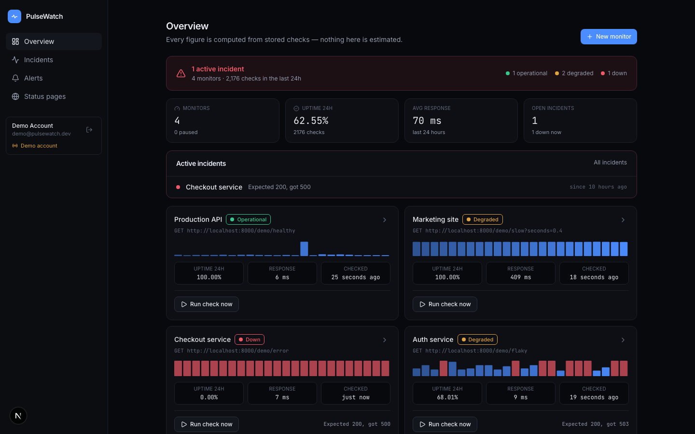
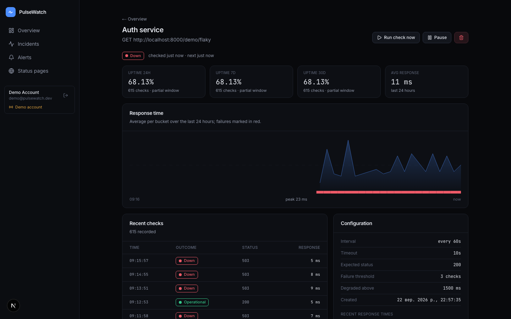
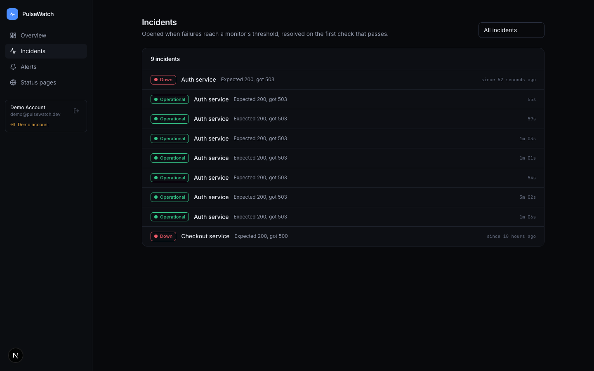
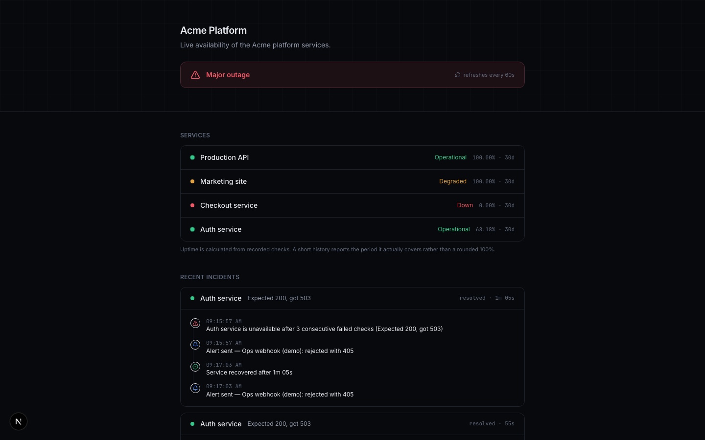
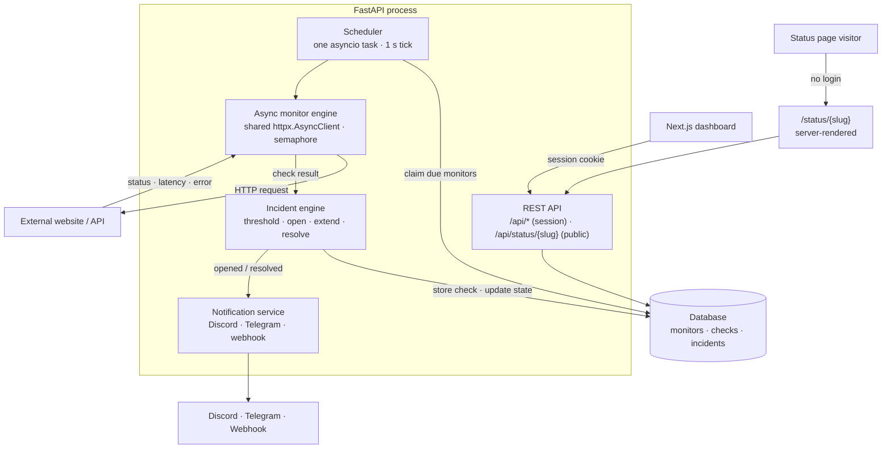
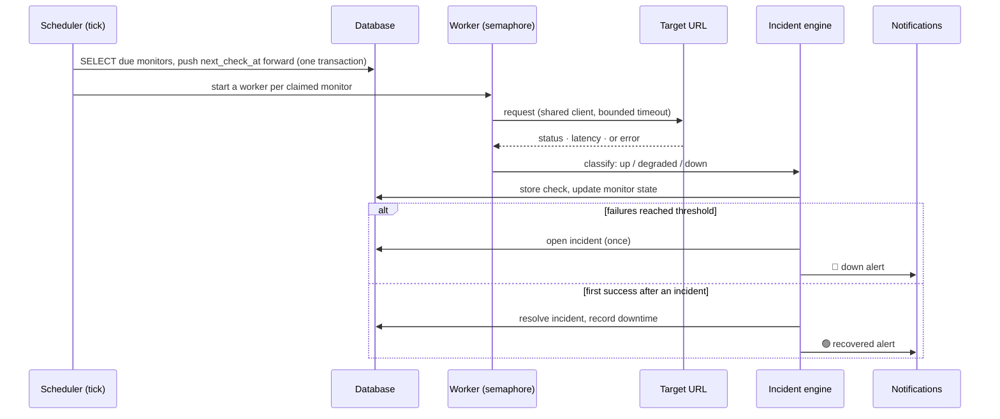

<div align="center">

# PulseWatch

**Portfolio case study:** [moeijiro.github.io/portfolio/projects/pulsewatch](https://moeijiro.github.io/portfolio/projects/pulsewatch/) · **Live demo:** not hosted — the app runs locally in a few commands (see below).

**HTTP uptime monitoring with incidents, alerts and public status pages.**

`FastAPI` · `asyncio` · `httpx` · `SQLAlchemy` · `Next.js` · `PostgreSQL-ready`

</div>

---

PulseWatch checks websites and APIs on a schedule, records every result, opens an incident
when failures cross a threshold, tells you about it on Discord, Telegram or a webhook, and
publishes the state of your services on a public status page.

It is a small, honest monitoring product — not enterprise observability. There are no agents,
no log ingestion, no metrics pipeline. The engineering effort went into the parts a
monitoring tool gets judged on: a scheduler that never double-checks, an incident model that
does not page anyone over one dropped packet, uptime figures that are never rounded up, and an
SSRF guard on a service whose whole job is making requests on someone else's behalf.

---

## Contents

- [Screenshots](#screenshots)
- [Features](#features)
- [Architecture](#architecture)
- [Monitoring lifecycle](#monitoring-lifecycle)
- [Incident logic](#incident-logic)
- [Alerts](#alerts)
- [Status pages](#status-pages)
- [Installation](#installation)
- [Environment variables](#environment-variables)
- [Running locally](#running-locally)
- [Tests](#tests)
- [Security considerations](#security-considerations)
- [Known production limitations](#known-production-limitations)
- [Project structure](#project-structure)

---

## Screenshots

| | |
|---|---|
|  |  |
| *Overview — every figure from stored checks* | *Monitor detail: uptime windows, response chart, history* |
|  |  |
| *Incidents with their timelines* | *Public status page, no login* |

> Captured from the running stack. The demo monitors point at this project's own `/demo`
> endpoints, and every check, incident and timeline entry in the screenshots was produced by
> the scheduler — including the incident on the flaky service, which opened after three
> failed checks and resolved on its own.

---

## Features

- **Monitors** — name, URL, method, interval, expected status, timeout, optional custom
  headers, per-monitor failure threshold and degraded-latency limit, pause and resume.
- **Async check engine** — one shared `httpx.AsyncClient` with connection pooling; checks
  are classified as `up`, `degraded` (slow) or `down` (wrong status, timeout, DNS, TLS,
  connection error) with a human-readable reason.
- **Scheduler** — a single asyncio task with atomic claiming, bounded concurrency and
  jitter; resumes exactly where it stopped after a restart.
- **Incidents** — opened after N consecutive failures, extended rather than duplicated,
  resolved automatically on recovery with the downtime recorded and a timeline of what
  happened.
- **Alerts** — Discord webhooks, Telegram bots and generic JSON webhooks, sent on down and on
  recovery. Credentials are encrypted at rest and masked in the UI.
- **Uptime** — 24 h / 7 d / 30 d windows computed from stored checks, which say when the
  data does not cover the whole window.
- **Status pages** — public, server-rendered, auto-refreshing, and deliberately free of URLs
  or configuration.
- **Run check now** — the same engine as the scheduler, on demand, with the real result.
- **Demo targets** — `/demo/healthy`, `/demo/slow`, `/demo/error`, `/demo/flaky`,
  `/demo/timeout` make demonstrations predictable without depending on the internet.

---

## Architecture



One process runs the API and the scheduler. That keeps the project runnable with two
commands; the consequences are spelled out under
[Known production limitations](#known-production-limitations).

---

## Monitoring lifecycle



Three details matter more than the loop itself:

1. **Claiming.** Due monitors have `next_check_at` pushed forward in the same transaction
   that selects them, and the claim is serialised within the process. A check that takes
   longer than its interval is never started twice.
2. **Bounded concurrency.** A semaphore caps checks in flight (`MAX_CONCURRENT_CHECKS`).
   A hundred monitors due in the same second queue rather than opening a hundred sockets.
3. **Jitter.** Up to ±10 % of the interval (capped at 15 s). Monitors created together would
   otherwise stay in lockstep forever and hit their targets as a spike.

Database work runs in worker threads so the loop keeps ticking while it waits; alerts are
sent after the write, so a slow webhook delays an alert, never the next check.

---

## Incident logic

| Check result | Counter | Monitor state | Incident |
|---|---|---|---|
| passes, fast | reset to 0 | `operational` | resolves an open one |
| passes, slower than `degraded_ms` | reset to 0 | `degraded` | resolves an open one |
| fails, below threshold | +1 | `degraded` | none yet |
| fails, reaches threshold | +1 | `down` | **opened** (once) |
| fails, already down | +1 | `down` | same incident, timeline extended |
| monitor paused | — | `paused` | not scheduled |

The threshold (default 3, configurable per monitor and globally) is what keeps a single
dropped packet from paging anyone at 3 am. An incident stores its reason, failure count,
start, resolution, duration, and a bounded timeline:

```
07:51:00  Auth service is unavailable after 3 consecutive failed checks (Expected 200, got 503)
07:51:00  Alert sent — Ops webhook: delivered (200)
07:51:55  Service recovered after 55s
```

---

## Alerts

```
🔴 Production API is DOWN

Monitor:       Production API
URL:           https://api.example.com/health
Reason:        Timeout after 10s
Failed checks: 3
Detected:      2026-09-22T14:22:03Z
```

```
🟢 Production API recovered

Downtime:  3m 14s
```

- **Discord** — incoming webhook URL (must be `https://discord.com/api/webhooks/…`).
- **Telegram** — bot token + chat ID, sent through the Bot API.
- **Webhook** — a JSON payload (`monitor.down` / `monitor.recovered`) POSTed to any public URL.

Each channel keeps delivered/failed counters and its last error, and has a **Test** button
that sends a real alert. `NOTIFICATIONS_DRY_RUN=true` renders and records alerts without
sending them — used by the test suite and handy for demos.

---

## Status pages

`/status/{slug}` is public and server-rendered on every request, so it can never serve a
cached "all good" during an outage. It shows the overall state, each selected service with
its 30-day uptime, and incidents from the last 14 days with their timelines. The page
refreshes itself every 60 seconds.

The public API behind it (`GET /api/status/{slug}`) returns service names, states, uptime and
incidents — **no URLs, no configuration, no owner**. A status page says what is up, not how
it is monitored.

---

## Installation

Requirements: Python 3.11+, Node 20+.

```bash
git clone https://github.com/Moeijiro/pulsewatch.git
cd pulsewatch
cp .env.example backend/.env
cp frontend/.env.example frontend/.env.local
make install
```

---

## Environment variables

Backend (`backend/.env`) — the full list with comments is in [`.env.example`](.env.example).

| Variable | Default | Purpose |
|---|---|---|
| `DATABASE_URL` | `sqlite:///./pulsewatch.db` | any SQLAlchemy URL |
| `SECRET_KEY` | dev placeholder | signs sessions, derives the credential key |
| `SCHEDULER_ENABLED` | `true` | run the scheduler in this process |
| `SCHEDULER_TICK_SECONDS` | `1` | how often due monitors are looked for |
| `MAX_CONCURRENT_CHECKS` | `20` | checks in flight at once |
| `MAX_CHECK_TIMEOUT_SECONDS` | `30` | ceiling on any monitor's timeout |
| `DEFAULT_FAILURE_THRESHOLD` | `3` | consecutive failures before an incident |
| `DEFAULT_DEGRADED_MS` | `1500` | slower than this counts as degraded |
| `CHECK_RETENTION_DAYS` | `30` | used by `make prune` |
| `ALLOW_PRIVATE_NETWORK_TARGETS` | `false` | the SSRF guard; refused in production |
| `NOTIFICATIONS_DRY_RUN` | `false` | record alerts without sending them |

Web (`frontend/.env.local`): `NEXT_PUBLIC_API_URL` (default `http://localhost:8000`).

---

## Running locally

```bash
make seed   # demo account with real check history (demo@pulsewatch.dev / pulsewatch-demo-1234)
make api    # API + scheduler on http://localhost:8000 — docs at /docs
make web    # dashboard on http://localhost:3000
```

The seed routes checks straight into the app through httpx's ASGI transport, so it needs no
server running. Once `make api` is up, the scheduler takes over and keeps checking the demo
monitors: a healthy API, a slow marketing site, a checkout service that always fails, and an
auth service that fails about a third of the time — enough to see incidents open and resolve
on their own. The public status page is at <http://localhost:3000/status/acme>.

---

## Tests

```bash
make test
```

32 tests. Checks are routed into the app's own `/demo` endpoints through an ASGI transport,
so the engine runs against real HTTP responses without touching the network.

- **engine**: healthy, slow (degraded), wrong status, timeout, and a private target refused
  before any request
- **incidents**: threshold of 1 and 3, one incident across repeated failures, recovery with
  downtime, the failure counter reset
- **scheduler**: claiming pushes the next check forward, paused monitors are never claimed,
  jitter stays within bounds, a tick runs and records checks, concurrency is bounded without
  dropping work
- **API**: authentication, ownership (another account gets 404), private URLs and forbidden
  headers refused, "Run check now", uptime and partial windows, masked credentials
- **status pages**: public with no session, no URLs leaked, unpublished pages hidden

---

## Security considerations

- **SSRF.** A monitoring service is an SSRF primitive by design. Every monitor URL and every
  notification destination is resolved and refused if it points at private, loopback,
  link-local or reserved space — at save time *and* at check time, so a DNS change cannot
  smuggle a target in later. The `/demo` endpoints are exempt by identity, so demos never
  require turning the guard off. Production refuses to start with the guard disabled.
- **Request limits.** Timeouts are capped server side, response bodies are read up to 64 KiB
  and discarded, a monitor may carry at most 10 headers and cannot set `Host`,
  `Content-Length`, `Connection` or `Transfer-Encoding`, and each account is limited to 50
  monitors.
- **Credentials.** Webhook URLs and bot tokens are encrypted with Fernet (key derived from
  `SECRET_KEY` via HKDF) and returned only as a masked hint. The Telegram token is part of a
  URL, so delivery errors report the error type, never the URL.
- **Accounts.** scrypt password hashing, HttpOnly session cookie, one answer for "no such
  account" and "wrong password", `404` rather than `403` for other people's objects.
- **Public surface.** The status page API exposes no URLs or configuration, is rate limited,
  and unpublished pages answer 404.

---

## Known production limitations

This is a portfolio-scale system, and it is honest about where that shows:

- **One scheduler.** The scheduler runs inside the API process. Run exactly one instance with
  `SCHEDULER_ENABLED=true`; horizontal scaling needs either a leader election or moving to
  `SELECT … FOR UPDATE SKIP LOCKED` claiming on PostgreSQL (the claim is isolated in
  `_claim_due`, so that change is local).
- **Single vantage point.** Checks come from one location, so a network problem on the
  monitoring host looks like an outage everywhere. Real products confirm failures from
  several regions before alerting.
- **Check volume.** Every check is a row. At 50 monitors checked each minute that is ~2.2
  million rows a month; `make prune` enforces retention, and a larger install would roll
  checks up into hourly aggregates.
- **SQLite.** Fine for local use and the demo; use PostgreSQL for anything shared.
- **Alerting is fire-and-forget.** A failed delivery is recorded on the channel and the
  incident timeline but not retried.

---

## Project structure

```
backend/
  app/
    api/routes/   auth · monitors · incidents · channels · status_pages · demo · system
    core/         config · security · errors · net (SSRF guard) · rate_limit
    db/           engine (WAL for SQLite), session, base
    models/       User · Monitor · MonitorCheck · Incident · NotificationChannel · StatusPage
    schemas/      Pydantic models, including the public status page shape
    services/
      scheduler.py      claim · bounded workers · jitter · lifecycle
      checker.py        one request, classified; never raises
      incidents.py      the state machine
      notifications.py  Discord · Telegram · webhook, dry-run mode
      uptime.py         windows, series, sparklines, dashboard figures
      http_client.py    the shared AsyncClient
    seed.py       demo account with real history
    cli.py        init-db · prune-checks
  tests/          32 tests
frontend/
  src/
    app/(app)/    overview · monitors/[id] · incidents · channels · status-pages
    app/status/   the public, server-rendered status page
    components/   dashboard shell, monitor card, charts (inline SVG), incident timeline
docs/screenshots/
```

Charts are inline SVG rather than a charting library: a sparkline per monitor card and one
response-time chart do not justify tens of kilobytes on a page whose job is to load fast.

---

## Licence

MIT — see [LICENSE](LICENSE).
